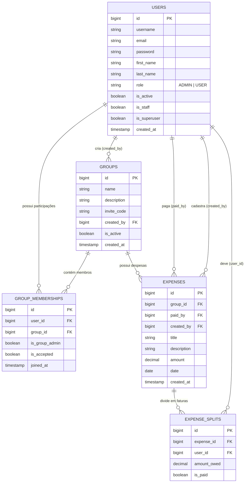

# Gestão de Despesas Django

## Descrição do Projeto

O projeto propõe facilitar o controle de despesas compartilhadas entre grupos, inspirado em ferramentas como o Splitwise. No Checkpoint 1, o foco implementado está na modelagem relacional e na administração dos dados pelo Django Admin. As interfaces de usuário final e os fluxos completos de participação e divisão de despesas permanecem planejados para etapas posteriores.

---
## Integrantes do Projeto

| INTEGRANTE | GITHUB |
| --- | --- |
| Gustavo Alessandro de Souza Sabino | [https://github.com/GUSTAVO-ALESSANDRO](https://github.com/GUSTAVO-ALESSANDRO) |
| Diego Alves de Oliveira | [https://github.com/diego-codev](https://github.com/diego-codev) |
| Caio Bueno Finocchio Martins | [https://github.com/caiobfm](https://github.com/caiobfm) |

---

## Tecnologias Utilizadas

O projeto foi construído utilizando a linguagem Python em conjunto com o framework Django, que fornece a arquitetura MVT, o sistema robusto de autenticação, o mapeamento objeto-relacional e a modularidade necessária para separar a aplicação em componentes reutilizáveis, garantindo organização e escalabilidade ao código-fonte.

Para o armazenamento persistente dos dados, o sistema emprega o banco de dados relacional PostgreSQL, assegurando a integridade referencial por meio de chaves estrangeiras, restrições e transações seguras, enquanto a interface do usuário foi estilizada com o framework CSS Bootstrap, oferecendo uma experiência responsiva, moderna e compatível com temas claros e escuros.

O controle de versão e a colaboração da equipe foram gerenciados através do Git e do GitHub, utilizando branches específicas para organização do fluxo de trabalho, e o painel administrativo do Django foi customizado com temas avançados para atender aos requisitos visuais e de filtragem propostos.

---

## Instruções para Instalação

Para executar o Checkpoint 1, tenha Python 3 e PostgreSQL disponíveis. Na raiz do repositório:

1. Clone o repositório e entre na pasta:

```bash
git clone https://github.com/GUSTAVO-ALESSANDRO/gestao-despesas-django.git
cd gestao-despesas-django
```

2. Crie e ative o ambiente virtual:

```bash
python3 -m venv venv
source venv/bin/activate

```

3. Instale as dependências:

```bash
pip install -r requirements.txt
```

4. Crie `.env` manualmente na raiz do projeto (não há `.env.example`). Preencha os valores abaixo; gere `SECRET_KEY` com `python3 -c "from django.core.management.utils import get_random_secret_key; print(get_random_secret_key())"`.

```bash
SECRET_KEY=chave-gerada
DEBUG=True
ALLOWED_HOSTS=localhost,127.0.0.1
DB_NAME=nome_do_banco
DB_USER=usuario_postgres
DB_PASSWORD=senha_postgres
DB_HOST=localhost
DB_PORT=5432

```

5. Crie o banco PostgreSQL indicado no `.env`, aplique as migrations e crie um administrador:

```bash
createdb -h localhost -p 5432 -U usuario_postgres nome_do_banco
python3 manage.py migrate
python3 manage.py createsuperuser
```

---

## Instruções para Execução

Após concluir a instalação e configurar o banco de dados, execute o servidor de desenvolvimento local com o seguinte comando:

```bash
python3 manage.py runserver
```

Com o servidor em execução, abra o seu navegador de preferência e acesse o endereço `[http://127.0.0.1:8000/](http://127.0.0.1:8000/)` para interagir com a aplicação web.

### Dados de demonstração (opcional)

`clear_and_populate.sql` corresponde às tabelas e relacionamentos atuais. **O script apaga todos os registros existentes e reinicia as sequências antes de inserir os dados de exemplo. Use somente em banco descartável de desenvolvimento/demonstração.** Execute depois de `migrate`; ele cria uma conta administrativa de demonstração (`admin` / `admin`), então não execute `createsuperuser` antes da população:

```bash
psql -h localhost -p 5432 -U usuario_postgres -d nome_do_banco -W -f clear_and_populate.sql
```

---

## Principais Funcionalidades

### Implementado no Checkpoint 1

* Dois apps Django (`accounts` e `expenses`), modelos relacionais e migrations para usuários, grupos, memberships, despesas e divisões.
* Django Admin personalizado com Jazzmin. O acesso depende de `is_staff`, permissões Django e `is_superuser`; `role=ADMIN` não promove um usuário a superusuário.
* Formulários de administração de usuários com senha armazenada por hash e redefinição pelo fluxo nativo do admin.
* Inlines de memberships na página do grupo e divisões na página da despesa.
* Filtros de usuários por perfil, status, participação em grupos e data; grupos por status, existência de despesas, quantidade de membros, criador e data; memberships por administrador, aceite e data; despesas por faixa de valor, situação das divisões, grupo, pagador e datas; divisões por quitação, faixa de valor, grupo e usuário. As listagens de memberships e divisões também têm seletores para restringir por grupo ou despesa.
* Gráficos de cadastros de usuários, grupos e despesas por semana, mês e ano. Usam o queryset filtrado da respectiva listagem e contam cadastros; não representam histórico de mudanças de status.
* Validações para o criador aceito e administrador do grupo, memberships sem duplicidade, pagador/cadastrador e participantes aceitos, e valores monetários positivos.

### Planejado para o Checkpoint 2

Cadastro, login e logout de usuários finais; páginas para gerenciar grupos e despesas; fluxos completos de convite e aprovação; divisão automática e atualização de quitação fora do admin.

---

## Modelagem do Banco de Dados



---

`GroupMembership` tem unicidade para o par usuário/grupo; `ExpenseSplit`, para despesa/usuário. O criador é associado como membro aceito e administrador. Pagador e cadastrador da despesa, assim como participantes das divisões, devem ser membros aceitos do grupo. Valores de despesa e divisão precisam ser maiores que zero. A soma das divisões não é validada nesta etapa, pois elas são editadas individualmente.

## Rotas disponíveis

| MÉTODO | ROTA | Explicação | Permissão |
| --- | --- | --- | --- |
| **GET** | `/` | Página inicial atual. | Pública |
| **GET** | `/admin/` | Django Admin com Jazzmin; acesso e operações dependem das permissões Django do usuário. | Usuário autenticado com acesso ao admin |

As rotas de cadastro e autenticação de usuários finais, e as operações de grupos e despesas fora do admin, ainda não estão implementadas. Os dados do Checkpoint 1 são gerenciados pelo `/admin/`.

---

## Estrutura do Projeto

A arquitetura do projeto segue a modularidade recomendada pelo Django, separando as responsabilidades principais entre o núcleo de configuração e os aplicativos específicos da regra de negócio:

```text
gestao-despesas-django/
├── manage.py
├── README.md
├── requirements.txt
├── .env (criado localmente; não versionado)
├── gestao_despesas/
│   ├── __init__.py
│   ├── asgi.py
│   ├── settings.py
│   ├── urls.py
│   └── wsgi.py
├── accounts/
│   ├── migrations/
│   ├── templates/
│   │   ├── admin/users.html
│   │   ├── base.html
│   │   └── index.html
│   ├── __init__.py
│   ├── admin.py
│   ├── apps.py
│   ├── models.py
│   ├── views.py
│   ├── urls.py
│   └── tests.py
├── expenses/
│   ├── migrations/
│   ├── templates/admin/
│   │   ├── expense.html
│   │   ├── expensesplit.html
│   │   ├── groups.html
│   │   └── groupmembership.html
│   ├── __init__.py
│   ├── admin.py
│   ├── apps.py
│   ├── models.py
│   ├── views.py
│   └── tests.py
├── static/
│   └── js/ (charts.js, theme.js)
└── staticfiles/ (saída gerada para arquivos estáticos)

```

* **gestao_despesas/**: Pasta principal que contém os arquivos de configuração global do projeto.
* **settings.py**: Arquivo onde são definidas as configurações gerais, conexões com o PostgreSQL, aplicativos instalados e middlewares.
* **urls.py**: Arquivo central que mapeia as rotas globais da aplicação web para os aplicativos correspondentes.


* **accounts/**: Modelo customizado de usuário e administração de usuários.
* **expenses/**: Modelos de grupos, memberships, despesas e divisões, com validações e configuração administrativa.
* **static/**: Scripts usados pelo tema e pelos gráficos do admin.


* **manage.py**: Utilitário de linha de comando principal do Django que permite interagir com o projeto para executar tarefas administrativas, como rodar o servidor de desenvolvimento, aplicar migrações e criar superusuários.
* **.env**: Arquivo de configuração local (não versionado) com chave, modo de execução, hosts e credenciais do PostgreSQL.
* **README.md**: Documentação principal do projeto que apresenta a visão geral do sistema, instruções de instalação, arquitetura de pastas e guias de execução.
