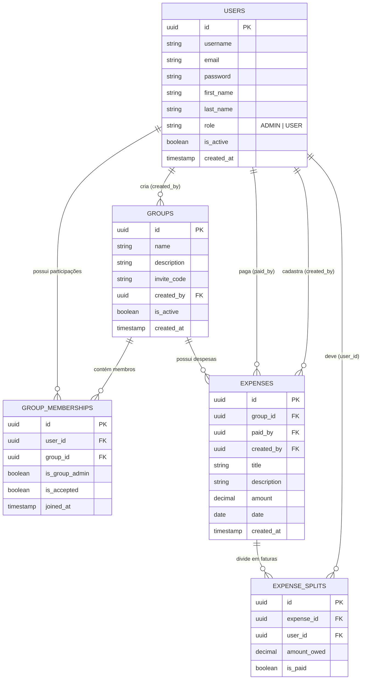

# Gestão de Despesas Django

## Descrição do Projeto

A aplicação web de gestão de despesas compartilhadas foi desenvolvida com o objetivo de facilitar o controle financeiro entre grupos de pessoas, inspirando-se no modelo de funcionamento de ferramentas como o Splitwise, onde os usuários podem organizar despesas comuns, registrar pagamentos e visualizar saldos parciais de forma automatizada. O sistema centraliza a administração de contas coletivas em um ambiente seguro, permitindo que os participantes criem círculos de gastos, ingressem por meio de códigos de convite exclusivos e acompanhem detalhadamente quem pagou e quem deve em cada transação, promovendo a transparência e o equilíbrio financeiro nas divisões.

---
## Integrantes do Projeto

| INTEGRANTE | GITHUB |
| --- | --- |
| Gustavo Alessandro de Souza Sabino | [https://github.com/GUSTAVO-ALESSANDRO](https://github.com/GUSTAVO-ALESSANDRO) |
| Diego Alves de Oliveira | [https://github.com/diego-codev](https://github.com/diego-codev) |
| Caio Bueno Finocchio Martins | [https://github.com/caiobfm](https://github.com/caiobfm) |

---

## Tecnologias Utilizadas

O projeto foi construído utilizando a linguagem Python em conjunto com o framework Django, que fornece a arquitetura MVT, o sistema robusto de autenticação, o mapeamento objeto-relacional e a modularidade necessária para separar a aplicação em componentes reutilizáveis, garantindo organização e escalabilidade ao código-fonte.

Para o armazenamento persistente dos dados, o sistema emprega o banco de dados relacional PostgreSQL, assegurando a integridade referencial por meio de chaves estrangeiras, restrições e transações seguras, enquanto a interface do usuário foi estilizada com o framework CSS Bootstrap, oferecendo uma experiência responsiva, moderna e compatível com temas claros e escuros.

O controle de versão e a colaboração da equipe foram gerenciados através do Git e do GitHub, utilizando branches específicas para organização do fluxo de trabalho, e o painel administrativo do Django foi customizado com temas avançados para atender aos requisitos visuais e de filtragem propostos.

---

## Instruções para Instalação

Para realizar a instalação do projeto em seu ambiente local, certifique-se de possuir o Python 3 e o PostgreSQL instalados na sua máquina, abra o terminal e siga os passos abaixo:

1. Clone o repositório oficial do projeto a partir do GitHub com o comando:

```bash
git clone https://github.com/GUSTAVO-ALESSANDRO/gestao-despesas-django.git

```
ou apenas instale o .zip desse repositório.

2. Acesse o diretório raiz do projeto clonado:

```bash
cd gestao-despesas-django

```

3. Crie e ative um ambiente virtual para isolar as dependências da aplicação:

```bash
python3 -m venv venv
source venv/bin/activate

```

4. Instale as dependências necessárias listadas no projeto:

```bash
pip install -r requirements.txt

```

5. Crie o arquivo `.env` a partir do modelo e preencha a `SECRET_KEY` e as credenciais de acesso ao banco de dados PostgreSQL:

```bash
cp .env.example .env
python3 -c "from django.core.management.utils import get_random_secret_key; print(get_random_secret_key())"

```

6. Aplique as migrações para criar as tabelas:

```bash
python3 manage.py makemigrations
python3 manage.py migrate

```

---

## Instruções para Execução

Após concluir a instalação e configurar o banco de dados, execute o servidor de desenvolvimento local com o seguinte comando:

```bash
python3 manage.py runserver

```

Com o servidor em execução, abra o seu navegador de preferência e acesse o endereço `[http://127.0.0.1:8000/](http://127.0.0.1:8000/)` para interagir com a aplicação web.

---

## Principais Funcionalidades

* Autenticação completa de usuários com suporte a cadastro, login e logout de sessão seguros.
* Gestão de perfis e papéis distintos, contemplando administradores gerais do sistema e usuários comuns.
* Criação, consulta e gerenciamento de grupos de despesas com geração automática de códigos alfanuméricos de convite.
* Sistema de aprovação de novos membros por parte do administrador do grupo.
* Cadastro, edição e exclusão lógica de despesas, permitindo detalhar o valor total, o título, a descrição e o responsável pelo pagamento.
* Divisão automática e individualizada de despesas entre os participantes do grupo com controle de quitação por fatia.
* Painel administrativo customizado e restrito aos administradores gerais, contendo métricas e relatórios globais de usuários e grupos ativos ou desativados.

---

## Modelagem do Banco de Dados



---

## Mapeamento de Rotas

| MÉTODO | ROTA | Explicação | Permissão |
| --- | --- | --- | --- |
| **POST** | `/auth/register/` | Processa o cadastro de uma nova conta de usuário comum no sistema. | Público |
| **POST** | `/auth/login/` | Autentica o usuário na sessão através de credenciais válidas. | Público |
| **POST** | `/auth/logout/` | Encerra a sessão ativa do usuário atual. | Usuário Autenticado |
| **GET** | `/users/` | Lista todos os usuários cadastrados no sistema. | Administrador Geral (`ADMIN`) |
| **POST** | `/users/` | Cria um novo usuário diretamente pela interface administrativa. | Administrador Geral (`ADMIN`) |
| **GET** | `/users/:id` | Exibe os dados cadastrais de um usuário específico. | Usuário Autenticado |
| **PUT** | `/users/:id` | Atualiza as informações cadastrais do usuário. | Usuário Autenticado |
| **DELETE** | `/users/:id` | Executa a exclusão lógica do usuário alterando o status `is_active`. | Administrador Geral (`ADMIN`) |
| **GET** | `/groups/` | Lista os grupos em que o usuário participa. | Próprio Usuário |
| **GET** | `/groups/` | Lista todos os grupos eexistentes. | Administrador Geral (`ADMIN`) |
| **POST** | `/groups/` | Cria um novo grupo, gera o código de convite e define o criador como administrador. | Usuário Autenticado |
| **GET** | `/groups/:id` | Exibe a página de detalhes do grupo como membros, despesas, etc. | Membros do Grupo ou Admin Geral (`ADMIN`) |
| **POST** | `/groups/:id` | Permite que o usuário ingresse em um grupo utilizando o código de convite. | Usuário Autenticado |
| **PUT** | `/groups/:id` | Atualiza as informações do grupo (nome ou descrição). | Admin do Grupo ou Admin Geral |
| **DELETE** | `/groups/:id` | Executa a exclusão lógica do grupo alterando o status `is_active`. | Admin do Grupo ou Admin Geral |
| **GET** | `/groups/:id/members/:user_id` | Exibe o status e os dados de um membro específico no grupo. | Membros do Grupo ou Admin |
| **PUT** | `/groups/:id/members/:user_id` | Aceita o membro (`is_accepted=True`) ou o promove a administrador do grupo. | Admin do Grupo ou Admin Geral |
| **DELETE** | `/groups/:id/members/:user_id` | Remove o membro do grupo (expulsão ou saída voluntária). | Admin do Grupo ou Admin Geral |
| **GET** | `/groups/:id/expenses/` | Lista todas as despesas cadastradas dentro do grupo específico. | Membros do Grupo ou Admin Geral |
| **POST** | `/groups/:id/expenses/` | Cadastra uma nova despesa no grupo e gera as divisões correspondentes. | Membros do Grupo |
| **GET** | `/groups/:id/expenses/:expense_id` | Exibe os detalhes completos de uma despesa específica. | Membros do Grupo ou Admin Geral|
| **PUT** | `/groups/:id/expenses/:expense_id` | Atualiza os dados de uma despesa já cadastrada. | Admin Geral, Admin do Grupo, Pagador ou Criador da Despesa |
| **DELETE** | `/groups/:id/expenses/:expense_id` | Exclui a despesa e remove suas faturas associadas. | Admin do Sistema, Admin do Grupo, Pagador ou Criador da Despesa |
| **GET** | `/groups/:id/expenses/:expense_id/members/` | Lista os participantes envolvidos na divisão da despesa. | Membros do Grupo |
| **POST** | `/groups/:id/expenses/:expense_id/members/` | Adiciona um novo participante para dividir a despesa específica. | Admin do Grupo, Pagador ou Criador da Despesa |
| **PUT** | `/groups/:id/expenses/:expense_id/members/:split_id/` | Altera o status de quitação da fatia (`is_paid`). | Devedor, Pagador, Criador ou Admin do Grupo |
| **GET** | `/dashboard/groups/` | Retorna métricas globais dos grupos (total, ativos e desativados). | Administrador Geral (`ADMIN`) |
| **GET** | `/dashboard/users/` | Retorna métricas globais dos usuários (total, ativos e desativados). | Administrador Geral (`ADMIN`) |

---

## Estrutura do Projeto

A arquitetura do projeto segue a modularidade recomendada pelo Django, separando as responsabilidades principais entre o núcleo de configuração e os aplicativos específicos da regra de negócio:

```text
gestao-despesas-django/
├── manage.py
├── README.md
├── requirements.txt
├── .env
├── gestao_despesas/
│   ├── __init__.py
│   ├── asgi.py
│   ├── settings.py
│   ├── urls.py
│   └── wsgi.py
├── accounts/
│   ├── migrations/
│   ├── templates/
│   ├── __init__.py
│   ├── admin.py
│   ├── apps.py
│   ├── models.py
│   ├── views.py
│   ├── urls.py
│   └── tests.py
├── expenses/
│   ├── migrations/
│   ├── templates/
│   ├── __init__.py
│   ├── admin.py
│   ├── apps.py
│   ├── models.py
│   ├── views.py
│   ├── urls.py
│   └── tests.py
├── static/
└── staticfiles/

```

* **gestao_despesas/**: Pasta principal que contém os arquivos de configuração global do projeto.
* **settings.py**: Arquivo onde são definidas as configurações gerais, conexões com o PostgreSQL, aplicativos instalados e middlewares.
* **urls.py**: Arquivo central que mapeia as rotas globais da aplicação web para os aplicativos correspondentes.


* **accounts/**: Aplicativo responsável pela gestão de usuários, autenticação, perfis e permissões.
* **expenses/**: Aplicativo responsável pela lógica de negócio principal, gerenciando grupos, códigos de convite, membros, despesas e faturas divididas.
* **static/**: Pasta dedicada ao armazenamento de arquivos estáticos como folhas de estilo CSS, scripts JavaScript e imagens para a interface Bootstrap.


* **manage.py**: Utilitário de linha de comando principal do Django que permite interagir com o projeto para executar tarefas administrativas, como rodar o servidor de desenvolvimento, aplicar migrações e criar superusuários.
* **.env**: Arquivo de configuração local (não versionado) que armazena de forma segura as variáveis de ambiente e credenciais sensíveis do banco de dados PostgreSQL.
* **README.md**: Documentação principal do projeto que apresenta a visão geral do sistema, instruções de instalação, arquitetura de pastas e guias de execução.